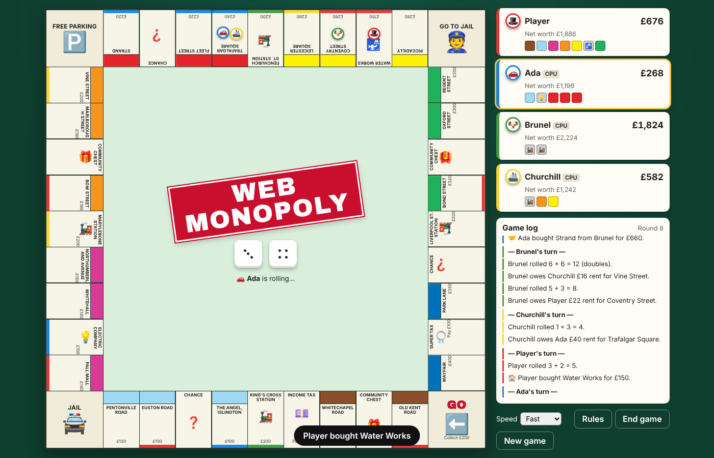

# Web Monopoly

A complete, browser-based take on the classic property-trading board game (London edition), written in plain HTML, CSS and JavaScript — no build step, no dependencies.

**Play it live: https://mangoomeh.github.io/web-monopoly/**



## Features
- 2–6 players: pass-and-play humans and/or CPU opponents, each with their own token
- Full rules: buying, rent (colour-set doubling, stations, utilities), houses & hotels with even building and a limited bank supply, mortgages (10% interest), Chance & Community Chest decks, Jail (doubles / £50 fine / Get Out of Jail Free cards, three-doubles rule), Income & Super Tax, bankruptcy
- Auctions for unbought property (optional)
- Trading property, Get Out of Jail Free cards and cash between players; CPUs judge deals by what each side gains (they won't hand you a colour set cheaply) and propose their own
- CPU difficulty per opponent: Easy, Normal or Hard (Hard sizes its cash reserve to the rent ahead, mortgages spare property to build, and prices property by what it does for rivals too)
- When a CPU turns down your trade it makes a counter-offer you can agree to or tweak
- CPU personalities (optional): each CPU is randomly a Steady player, Collector, Developer, Hoarder, Dealmaker or Gambler
- Round events (optional): a surprise every round, such as a building boom, rent strike, heatwave, tax holiday or council rates
- CPU moves (building, trades, raising cash) are shown on screen long enough to follow, even at Instant speed
- After the game ends you can close the results to look over the final board and game log
- Single player: a daily challenge (same deal for everyone each day), six scenarios, a career record with 18 achievements, and CPU chatter
- Optional Free Parking jackpot house rule, adjustable starting cash and CPU speed
- Animated tokens and dice, game log, title-deed cards (click any property)
- Auto-saves to your browser at the end of every turn
- Responsive: works on desktop and phones
- Installable PWA: add it to your home screen / desktop and play offline

## Running locally
Open `index.html` in a browser, or serve the folder:
```
python3 -m http.server
```

## Project layout
- `index.html` – page shell
- `css/style.css` – board and UI styling
- `js/data.js` – board spaces, cards, rules constants
- `js/game.js` – game engine, CPU logic and rendering
- `js/solo.js` – single-player extras: career & achievements, daily challenge, scenarios, CPU chatter
- `manifest.webmanifest`, `sw.js`, `icons/` – PWA install & offline support (bump `CACHE` in `sw.js` when shipping changes)

## History
Originally built as a project for GA SEI-33; rebuilt from the ground up as a full game.
